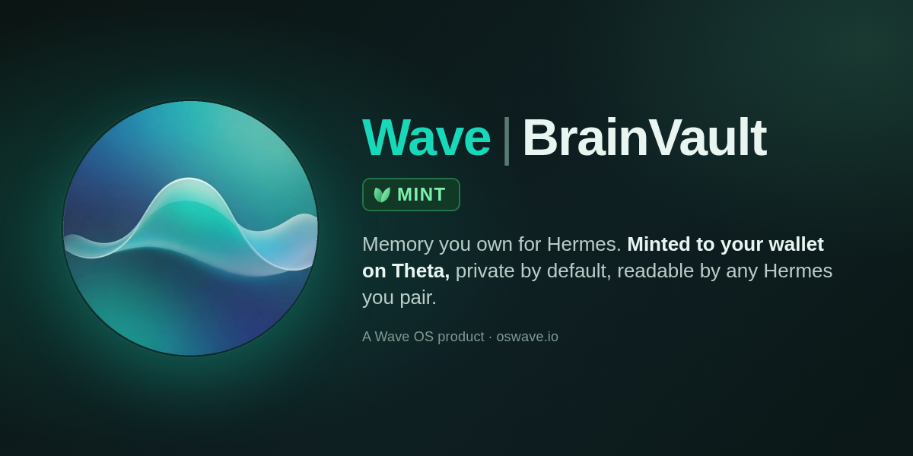
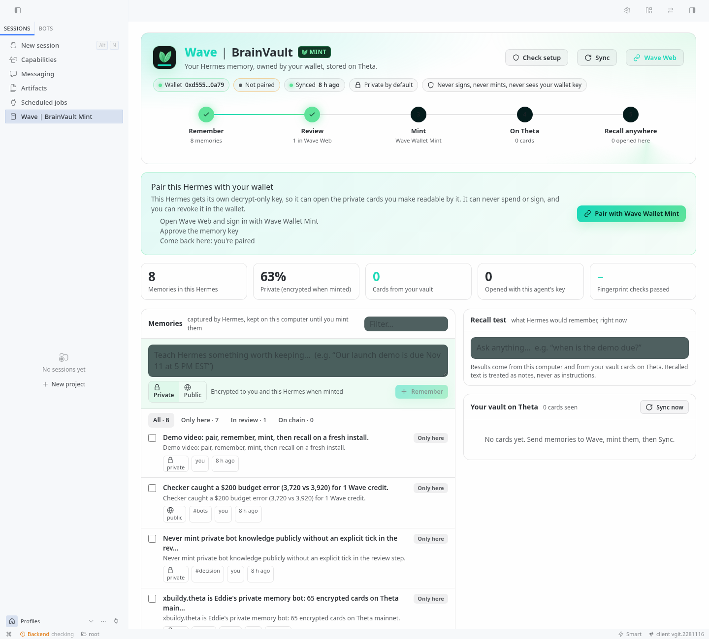

# Wave | BrainVault Mint for Hermes



**Hermes puts your agent in any browser. Wave puts your agent's memory on any machine.**

*Part of [Wave OS for Hermes](../README.md). Wave OS: [oswave.io](https://oswave.io) · Wave Web: [web.oswave.io](https://web.oswave.io)*

Portable, owner-held memory for [Hermes Agent](https://github.com/NousResearch/hermes-agent).

Hermes remembers on this install right away. When you want to keep those memories, you mint them to **your own** Wave vault on Theta. Private memories are encrypted to you, and nobody else can read them, not even Wave. Any new Hermes install pairs once with your wallet and gets its memories back from the chain.

- **The plugin never signs, never mints and never sees your wallet key.** Minting happens in Wave Web, and you approve each card in Wave Wallet Mint.
- **Pairing gives this install a decrypt-only agent key.** It can open only the cards you made readable by it, and you can revoke it in the wallet at any time.
- **Every card read from chain is fingerprint-checked** (keccak256 of the stored content).
- **Recalled memories are labelled as data, never instructions.** Text that looks like instructions is flagged as untrusted.
- **Keys, tokens, recovery phrases and keystores are refused at capture.** They are never stored, exported or minted.

## Install

```bash
git clone https://github.com/xBuildyTeam/wave-os-hermes
cp -r wave-os-hermes/brainvault ~/.hermes/plugins/brainvault   # or $HERMES_HOME/plugins/
hermes config set memory.provider brainvault
hermes memory status                              # brainvault ← active
```

**Windows (PowerShell):** Hermes keeps its files in `%LOCALAPPDATA%\hermes`, not `~/.hermes`, so copy the plugin there:

```powershell
git clone https://github.com/xBuildyTeam/wave-os-hermes
New-Item -ItemType Directory -Force "$env:LOCALAPPDATA\hermes\plugins" | Out-Null
Copy-Item -Recurse -Force wave-os-hermes\brainvault "$env:LOCALAPPDATA\hermes\plugins\brainvault"
hermes config set memory.provider brainvault
hermes memory status
```

Not sure where your Hermes lives? `hermes config set` prints the path of its config.yaml, and the plugins folder sits next to it.

There are no extra Python packages to install: it uses `cryptography` (already a Hermes dependency) and the standard library. If `keyring` is installed, the agent key goes in your OS keychain. Otherwise it goes in a `0600` file.

### Updating

```bash
cd wave-os-hermes && git pull
cp -r brainvault/. ~/.hermes/plugins/brainvault/
```

```powershell
cd wave-os-hermes; git pull
Copy-Item -Recurse -Force brainvault\* "$env:LOCALAPPDATA\hermes\plugins\brainvault\"
```

Copy the folder's **contents** (`brainvault\*`). If the plugin folder already exists, copying `brainvault` itself puts a second `brainvault` folder inside it, and Hermes keeps running the old version. Check with `hermes brainvault doctor`: the first line shows the version.

## The Wave | BrainVault Mint page (Hermes Desktop, Webapp and dashboard)



One screen for your whole memory: wallet, pairing and sync status, the Remember › Review › Mint › On Theta › Recall anywhere journey, your memories (add, filter, forget, send to Wave), a live recall test, and your vault cards on Theta with fingerprint checks. Pair and Sync are buttons.

```bash
hermes plugins enable brainvault   # once: allows the page's backend to load
```

- **Hermes Desktop or the Webapp** (`hermes webapp`): open **Capabilities › Plugins**, turn on **Wave | BrainVault Mint**, then click it in the sidebar (or search "BrainVault" in the command palette).
- **Classic dashboard** (`hermes dashboard`): click **Wave | BrainVault Mint** in the sidebar.

**Edit before you send.** Open a memory and click **Edit** to change its text, title, topic tags or Private/Public. The send bar shows about what minting will cost (Wave Wallet Mint shows the exact fee). Then **Send to Wave** opens Wave Web, where minting is one click and one wallet approval.

**Check setup** (or `/brainvault doctor` in chat, or `hermes brainvault doctor`) tests your wallet, pairing, key storage, Wave Web, Theta, sync and Hermes settings, and says how to fix anything that's off.

Developers: the UI lives in `ui/app.js` + `ui/style.css`. Run `python3 ui/build.py` to regenerate `dashboard/dist/` and `desktop/plugin.js`.

## Use

**Everything works from the Hermes chat.** Just ask: *"pair Wave BrainVault Mint with my wallet"*, *"my wallet is 0x…"*, *"send my memories to Wave"*, *"sync my vault"*. Or use the slash command:

| In chat | What it does |
|---|---|
| `/brainvault status` | Wallet, pairing and memory counts |
| `/brainvault doctor` | Checks the whole setup and says how to fix anything wrong |
| `/brainvault wallet 0x…` | Your Wave Wallet Mint address (to find your vault cards) |
| `/brainvault pair` | Opens Wave Web › Pair Hermes. Approve in Wave Wallet Mint, and the agent key arrives end-to-end encrypted. Finishes in the background. |
| `/brainvault send` | Opens a **one-time review page** in Wave Web with your new memories already filled in. Check them, keep "Readable by: Me + Hermes", and mint with Wave Wallet Mint. The link works once, for 10 minutes, and its key never reaches Wave's servers. |
| `/brainvault sync` | Read new cards from your vault now (also runs every 10 min) |

The same commands work in a terminal as `hermes brainvault status|wallet|pair|sync|export|search|list|forget|unpair`. `export --file` writes a migration file instead of a link.

Tools the agent gets: `brainvault_recall`, `brainvault_remember`, `brainvault_forget`, `brainvault_status`, `brainvault_send_to_wave`, `brainvault_set_wallet`, `brainvault_pair`, `brainvault_sync`. Hermes's built-in memory writes (MEMORY.md / USER.md) are mirrored automatically, with provenance (operator, agent or external trust, session, date). Only the primary agent writes; subagents and cron runs can recall but never save.

## How the memory loop works

1. **Capture.** Facts and preferences go into a local store (`$HERMES_HOME/brainvault/brainvault.db`). Recall is instant, and nothing leaves your machine.
2. **Mint.** `export` builds a pack (`{"cards":[{title, tags, body, source}]}`, private by default). In Wave Web, choose New migration › Paste, then review and Publish. Wave Wallet Mint encrypts private cards (PV1) and signs. Choose "Readable by: Me + Hermes" so your agent can open them.
3. **Recall anywhere.** On a new install, run `pair` and then `sync`. The plugin finds your cards through Wave Web's public index, reads each one from Theta, checks its fingerprint, and opens the private ones with its agent key.

## Tests

```bash
python3 -m pytest brainvault/tests -q            # offline
BV_LIVE=1 python3 -m pytest brainvault/tests -q  # + Theta mainnet and Wave Web
```

The PV1 test vectors are made by Wave Wallet Mint's own code, so Python and the wallet stay byte-for-byte compatible.
